Interfaz realizada en powerpoint 
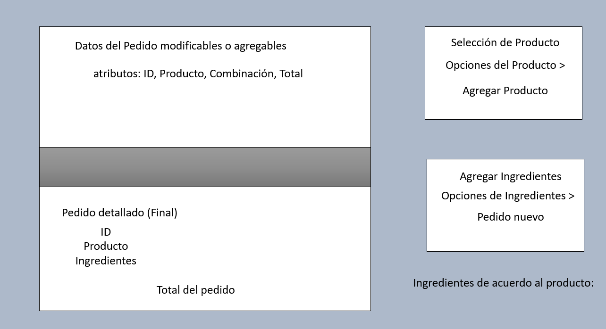
Interfaz pedida a Stitch para que sea más sencilla e intuitiva
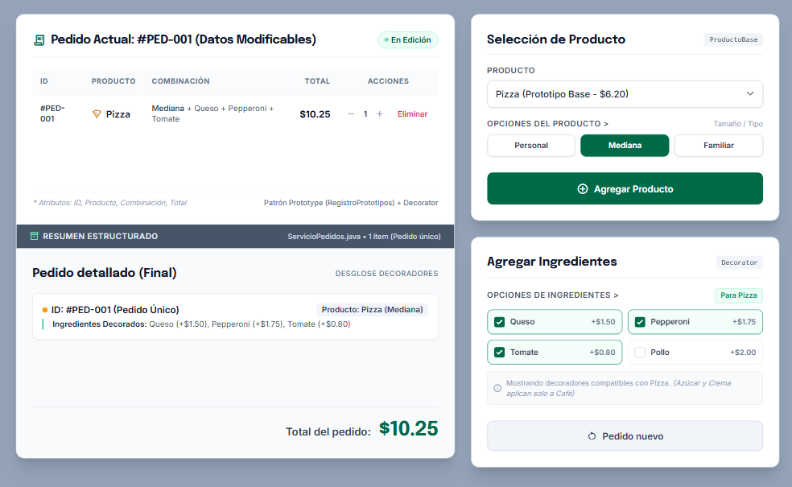

# Evidencias APP1 — PedidoLab

**Repositorio:** https://github.com/angelocarchipulla425-svg/icc-pap-pl1-patrones/blob/main/app/src/main/java/readme/evidencias.md

**Estudiante:** Angelo Miguel Carchipulla Pulla  
**Fecha:** 2026-11-08

| Caso | Entrada | Resultado esperado | Resultado real | Evidencia | Estado |
|---|---|---|---|---|---|
| CA01 | Clonar Café dos veces | IDs diferentes (`P-001`, `P-002`); ambos empiezan en $2.20 | Se generaron con IDs distintos e inicializaron correctamente en $2.20 | 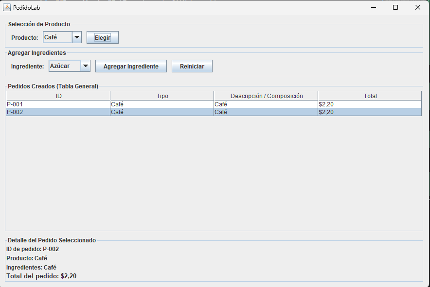 | Exitoso |
| CA02 | Comparar clon y objeto del registro | Referencias distintas; el prototipo conserva su configuración | Los objetos apuntan a memorias independientes sin alterar el catálogo base | 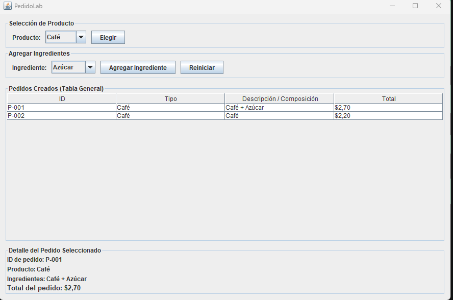 | Exitoso |
| CA03 | Al primer Café agregar Azúcar y Crema | Descripción incluye los dos ingredientes; total $3.90 | Descripción: "Café + Azúcar + Crema" con precio acumulado de $3.90 | 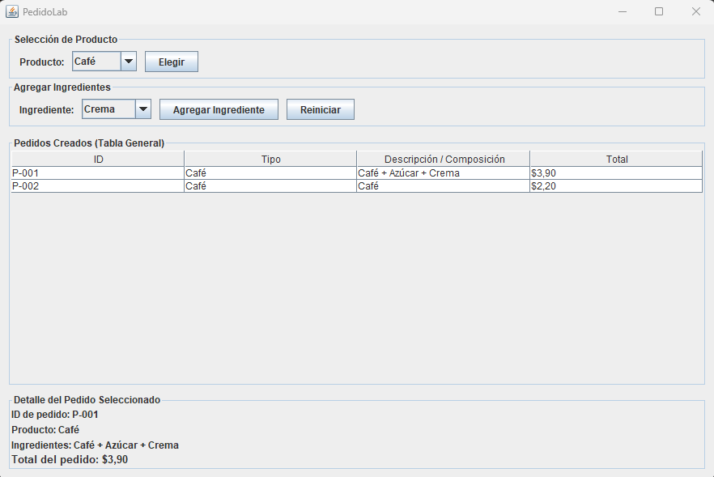 | Exitoso |
| CA04 | Consultar el segundo Café sin ingredientes | Mantiene $2.20, sin ingredientes | El segundo café conserva su estado original intacto de $2.20 | 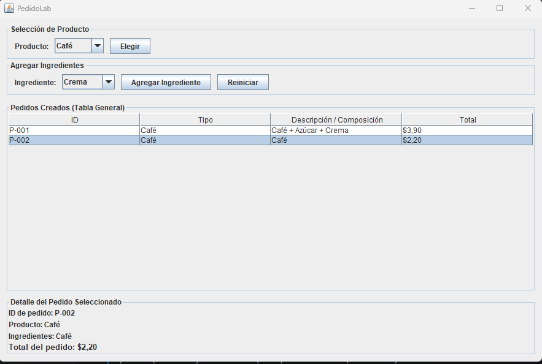 | Exitoso |
| CA05 | Clonar Ensalada y agregar Tomate y Pollo | Total $5.60 | Descripción con ingredientes y cálculo correcto de $5.60 | 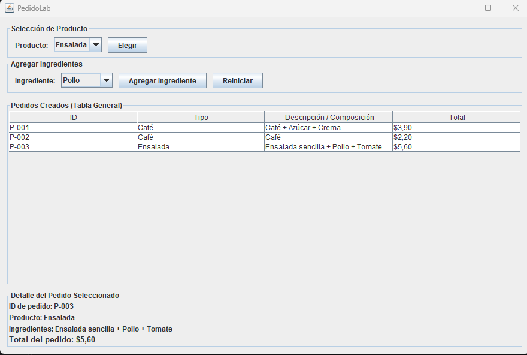 | Exitoso |
| CA06 | Clonar Pizza y agregar Queso y Pepperoni | Total $7.10 | Descripción con ingredientes y cálculo correcto de $7.10 | 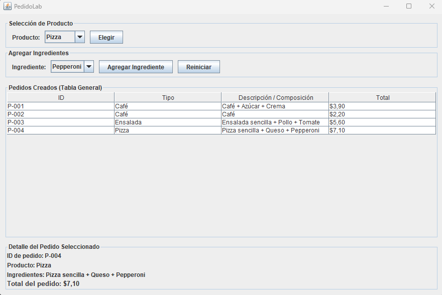 | Exitoso |
| CA07 | Intentar agregar Queso a Café | Operación rechazada; total y descripción no cambian | Se lanza validación y la interfaz bloquea el cambio por incompatibilidad | 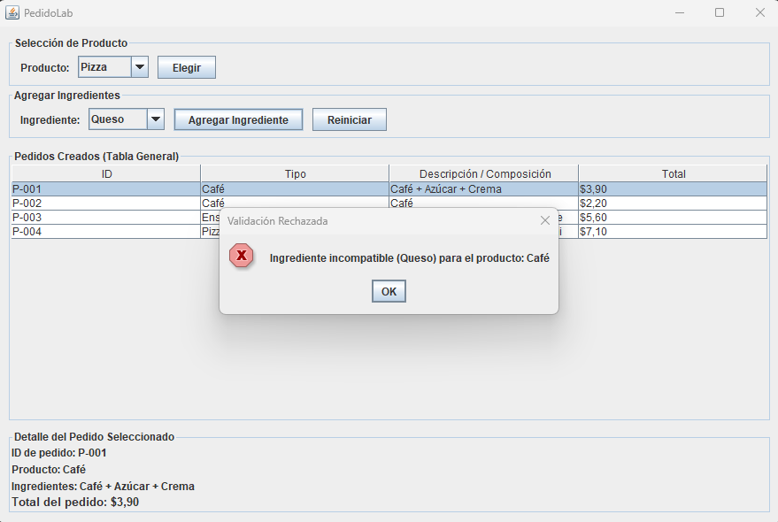 | Exitoso |
| CA08 | Agregar ingrediente sin pedido seleccionado | Mensaje claro y ningún cambio de estado | Muestra advertencia y no altera ningún pedido | 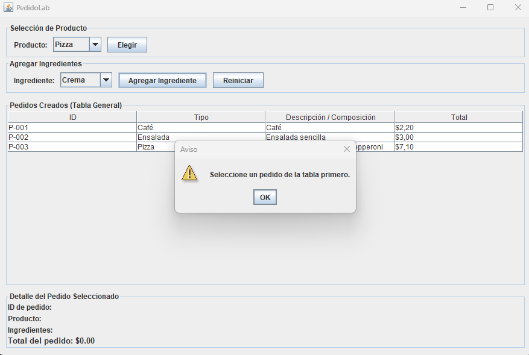 | Exitoso |
| CA09 | Solicitar clon de clave inexistente | Fallo controlado; no se crea pedido | Excepción controlada desde el registro sin romper la app | 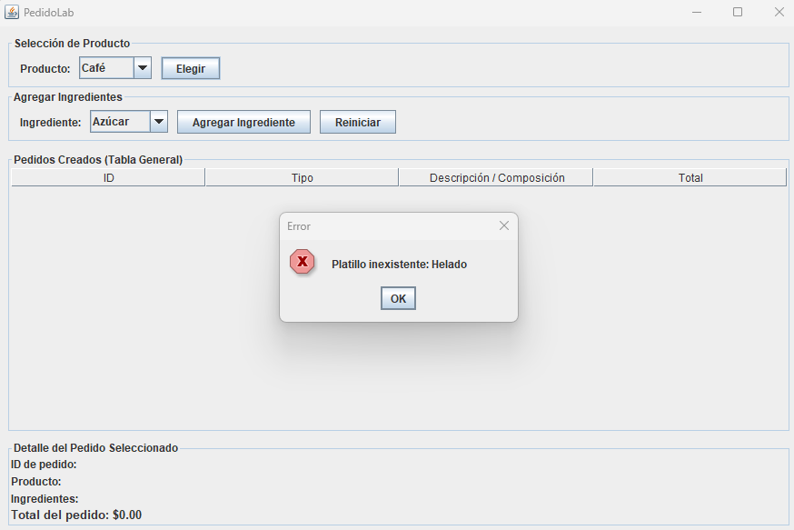 | Exitoso |
| CA10 | Agregar dos veces Azúcar a un Café | Total $3.20 y dos aplicaciones del decorador | Permite repetir ingrediente compatible sumando correctamente ($2.20 + $0.50 + $0.50 = $3.20) | 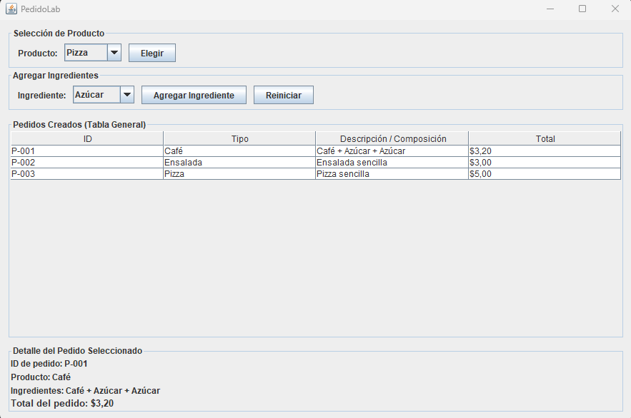 | Exitoso |
| CA11 | Reiniciar y volver a clonar Café | Nuevos pedidos parten nuevamente del valor base $2.20 | La lista se limpia, el contador reinicia en P-001 y los nuevos clones parten de $2.20 | 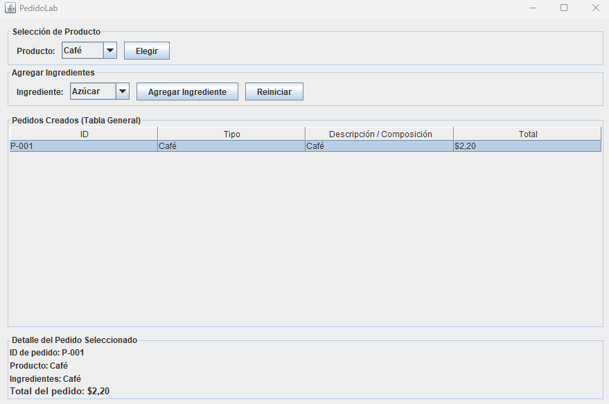 | Exitoso |

## Identificación de patrones

- **Prototype:** Implementado en la clase abstracta `PlatilloBase`, su método `clonar(String nuevoId)`, y gestionado a través de `RegistroPlatillos` (que almacena prototipos base y devuelve copias profundas independientes).
- **Decorator:** Implementado mediante la clase abstracta `IngredienteAdicional` que implementa la interfaz `Pedido` y mantiene una referencia interna a otro `Pedido`, conectándose con los decoradores concretos (`Azucar`, `Crema`, `Tomate`, `Pollo`, `Queso`, `Pepperoni`).
- **Integración:** Ocurre en el método `agregarIngrediente()` de la clase `AdministradorPedidos`, donde un platillo clonado del registro es envuelto dinámicamente por uno o más decoradores, conservando su ID único y calculando el precio al instante.

## Decisiones de diseño

1. **Usar `ArrayList` en lugar de `HashSet`:** Preferí una lista simple porque los pedidos salgan en la tablita bien ordenados tal cual el cliente los va creando (del P-001 en adelante), y además nos facilita buscar y reemplazar el objeto exacto por su índice cuando le metemos los ingredientes.
2. **Separar toda la lógica de la vista:** Toda la lógica del negocio (la clonación, las reglas de qué ingrediente sí y cuál no, y los cálculos) la tiramos directo a la clase de servicio (`AdministradorPedidos`). Así la interfaz gráfica (`PantallaPedidos`) se queda bien limpia, solo encargándose de recibir los clics y pintar los datos.

## Conclusiones

1. Usar clonación con el patrón Prototype ayudó para no escribir un montón de condicionales repetidos y dejó sacar pedidos nuevos con su propio ID y memoria libre, sin dañar para nada el menú original.
2. El patrón Decorator es bueno porque te deja armar combinaciones de ingredientes al momento (anidando objetos uno sobre otro) sin tener que crear una clase distinta para cada mezcla posible.
3. Haber dejado las validaciones de compatibilidad en la capa de servicio hizo que la interfaz no se sature, evitando errores ilógicos como querer meterle queso al café y manteniendo todo el sistema bajo control.